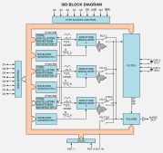

# Демо buildex: микро-SoC

Эта документация собрана из YAML-описаний в `src/demo/spec/`. Все рисунки и таблицы построены генератором.

1. [Система команд и константы](01_isa.md)
2. [Регистры, карта памяти, выводы](02_registers.md)
3. [Временные диаграммы](03_timing.md)
4. [Конечные автоматы](04_fsm.md)

Полный список сущностей: [gen/index.md](gen/index.md).

Системная частота — **{{const:CLK_MHZ}} МГц**, объём SRAM — **{{const:SRAM_KIB}} КиБ**, скорость UART по умолчанию — {{const:UART_BAUD}} бод.

{{include:_shared/legend.md}}

## Архитектура

Эта картинка нарисована вручную и лежит в `images/` — генератор её просто копирует:

